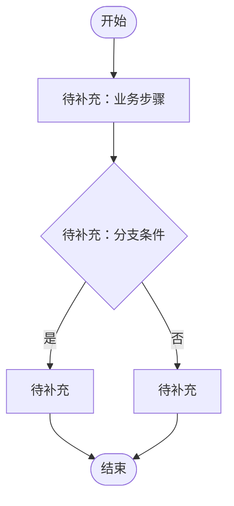

<!--
【文档说明】
承载内容：业务流程描述，承载端到端流程、参与方、分支、异常和流程图。
适用范围：proposal/specs/design 阶段用于需求理解和业务建模；tasks/apply 阶段用于校准业务语义。
填充指引：由需求文档、访谈纪要、现有系统文档、代码枚举和 context-update 补充；通用业务知识不要带省份、客户身份或单项目标记。
加载建议：命中业务术语、流程、规则、核验或对象边界时加载。
-->
# 业务流程描述（Business Process）

> 本文提供业务流程上下文的通用结构。具体流程、参与方、分支和系统交互由 context-update 按项目补充。

---

## 一、流程维护规则

| 项 | 要求 |
|---|---|
| 流程来源 | 需求原文、业务手册、页面流程、接口链路、后台任务和人工确认 |
| 表达粒度 | 先写业务动作，再补系统动作；避免把代码细节混入业务流程 |
| 分支记录 | 每个条件分支说明触发条件、失败提示和后续状态 |
| 证据关联 | 关键步骤关联接口、表、枚举、配置或代码符号 |
| 更新方式 | context-update 更新流程时同步检查业务规则、接口目录和数据模型 |

---

## 二、流程清单索引

| 流程编号 | 流程名称 | 触发场景 | 主要参与方 | 填充状态 |
|----------|----------|----------|------------|----------|
| 待补充 | 待补充 | 待补充 | 待补充 | 待 context-update 补充 |

---

## 三、单流程描述模板

### 3.1 流程概览

| 项 | 内容 |
|----|------|
| 流程名称 | 待补充 |
| 业务目标 | 待补充 |
| 触发条件 | 待补充 |
| 结束条件 | 待补充 |

### 3.2 流程图占位

### 3.3 流程步骤模板

| 步骤 | 业务动作 | 系统动作 | 关键输入 | 关键输出 | 证据 |
|------|----------|----------|----------|----------|------|
| 1 | 待补充 | 待补充 | 待补充 | 待补充 | 接口/表/页面 |
| 2 | 待补充 | 待补充 | 待补充 | 待补充 | 待补充 |

---

## 四、异常与分支模板

| 场景 | 触发条件 | 处理方式 | 用户可见结果 | 后台状态 |
|------|----------|----------|--------------|----------|
| 待补充 | 待补充 | 待补充 | 待补充 | 待补充 |

---

## 五、系统交互映射模板

| 流程环节 | 前端 | BFF/PSV | BSV/业务服务 | 外部系统/后台任务 |
|---------|------|---------|--------------|------------------|
| 待补充 | 待补充 | 待补充 | 待补充 | 待补充 |

---

## 六、关键设计要点

| 要点 | 说明 |
|------|------|
| 前后端职责 | 前端负责交互和轻量校验，权威业务规则在后端 |
| 幂等 | 正式提交、外部调用和后台任务必须设计幂等键 |
| 状态机 | 有状态对象需明确状态流转与终态 |
| 证据 | 流程图中的每个系统动作应能追溯到接口、配置、表或代码 |
