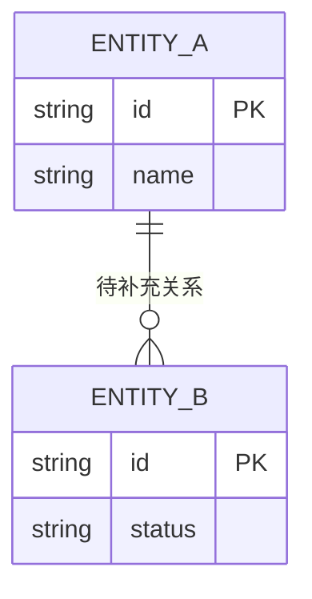

<!--
【文档说明】
承载内容：数据模型概览，承载实体关系、核心表、字段含义和数据约定。
适用范围：需求理解、数据设计、后端编码、DAO/BO 实现和验证阶段使用。
填充指引：由数据库字典、DDL、BO/.bo、DAO、枚举常量、配置表、GitNexus 和 context-update 补充；字段事实必须带来源，避免臆造。
加载建议：命中表、字段、枚举、数据归属、主数据源、状态流转或落库方案时加载。
-->
# 核心数据模型概览与实体关系

> 本文提供数据模型上下文的概览结构。具体实体、表名、字段、主键和关系必须由数据库字典、`.bo`、DAO、接口字段或人工确认补充。

---

## 一、数据域划分

| 数据域 | 英文标识 | 核心实体 | 主责系统 | 说明 |
|--------|---------|---------|----------|------|
| 待补充 | 待补充 | 待补充 | 待确认 | 待 context-update 补充 |

---

## 二、核心实体清单模板

| 实体 | 业务含义 | 常见关系 | 证据来源 |
|------|----------|----------|----------|
| 待补充 | 待补充 | 待补充 | DDL/.bo/DAO/接口 |

---

## 三、实体关系图占位

> 上图仅为结构占位；具体实体名、字段名和关系类型须由项目证据替换。

---

## 四、表级补充模板

| 表/实体 | 数据域 | 主键 | 关键字段 | 业务含义 | 证据 |
|---------|--------|------|----------|----------|------|
| 待补充 | 待补充 | 待补充 | 待补充 | 待补充 | DDL/.bo/DAO/接口 |

---

## 五、数据约定

| 约定项 | 规范 |
|--------|------|
| 字段事实 | 字段名、类型、枚举和含义必须可追溯 |
| 关系事实 | 一对一、一对多、多对多关系需有表或代码证据 |
| 状态字段 | 状态枚举在枚举字典维护 |
| 分库字段 | 路由键和 datasource 在数据归属/数据库规范中维护 |
