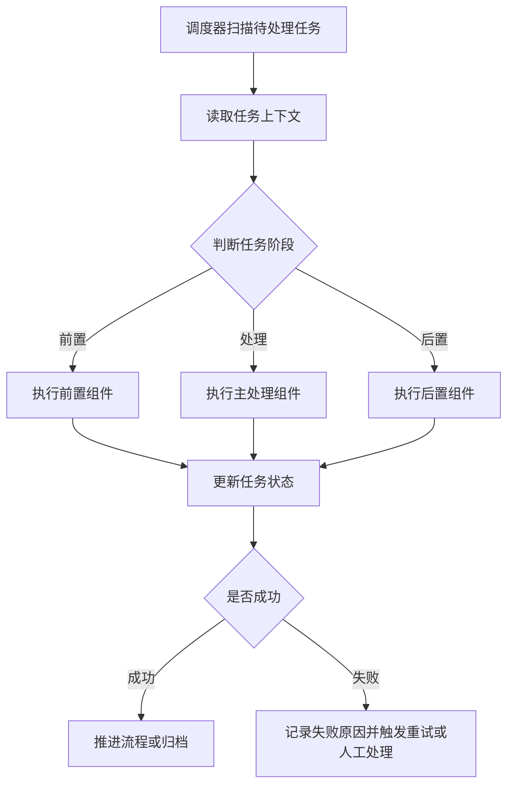

<!--
【文档说明】
承载内容：ET/后台调度组件指南，承载异步任务架构、组件类型、配置对象、幂等、状态维护和测试清单。
适用范围：后端异步处理、后台任务终态、调度任务的设计、编码和验证阶段使用。
填充指引：由目标项目 ET/Task/Job 代码、配置表、状态机、运维规则和 context-update 补充；不要沉淀具体 handle 类或单业务流程代码。
加载建议：命中 ET、Task、后台调度、异步处理、重试补偿或状态推进时加载。
-->
# ET 后台调度组件编码指南（ET Dispatch Guide）

> 本文只保留后台调度/异步任务类框架的通用结构。具体表名、包路径、基类、SPI 接口、配置表、状态码、服务编码和组件实现方式，必须以目标项目既有 ET/Task/Job 代码与 project-profile 为准。

---

## 一、框架架构

### 1.1 核心架构流程

### 1.2 核心模块

| 模块 | 说明 |
|------|------|
| 调度入口 | 按时间、状态、消息或人工触发扫描待处理任务 |
| 任务上下文 | 保存业务主单、子任务、流程实例、扩展参数和执行结果 |
| 组件定义 | 描述组件编码、组件类型、执行方式、目标类或服务编码 |
| 规则定义 | 描述不同场景、阶段、状态下应执行哪些组件 |
| 状态维护 | 负责任务推进、失败记录、重试次数、终态归档 |
| 外部调用 | 通过项目既有 CSF/HTTP/MQ/本地服务封装调用下游能力 |

### 1.3 核心配置对象

| 对象 | 作用 |
|------|------|
| 任务/流程实例 | 记录待执行工作单元、阶段、状态、路由键和执行结果 |
| 组件定义 | 记录组件类型、执行方式、启停状态、目标实现和描述 |
| 规则定义 | 记录业务场景到组件链路的映射 |
| 重试/告警配置 | 记录最大重试次数、失败策略、告警方式和人工处理入口 |

---

## 二、后台任务适用场景

### 2.1 建议走后台任务

| 场景 | 原因 |
|------|------|
| 下游处理耗时较长 | 避免同步接口超时，便于重试和补偿 |
| 需要多阶段推进 | 可将前置、主处理、后置、终态处理拆成独立阶段 |
| 依赖外部系统稳定性 | 可记录失败原因并按策略重试或转人工 |
| 需要幂等和可追溯 | 任务实例天然承载状态、流水和执行日志 |

### 2.2 不建议走后台任务

| 场景 | 推荐方式 |
|------|---------|
| 纯查询、无状态变更 | 同步服务接口 |
| 用户必须立即得到最终结果 | 同步流程或短事务编排 |
| 逻辑只影响页面展示 | 页面服务层或前端处理 |
| 无明确重试/补偿价值 | 普通服务调用即可 |

### 2.3 需要人类确认的决策

| 问题 | 原因 |
|------|------|
| 是否允许异步最终一致 | 影响用户体验、业务状态和验收口径 |
| 失败后如何处理 | 需要明确重试、告警、转人工或回滚策略 |
| 幂等键如何确定 | 影响重复调度、重复调用下游和重复落库风险 |
| 状态机如何设计 | 影响任务推进、补偿和归档规则 |

---

## 三、组件类型

| 组件类型 | 通用职责 | 适用场景 | 注意事项 |
|---------|---------|---------|---------|
| 前置组件 | 做参数补全、资格检查、上下文准备 | 主处理前必须满足的条件 | 不应产生不可回滚的外部副作用 |
| 主处理组件 | 执行业务主动作或调用核心下游能力 | 核心业务处理、下游同步等主流程 | 必须具备幂等保护和失败记录 |
| 后置组件 | 做通知、状态回写、归档、后处理 | 主处理成功或阶段结束后 | 明确失败是否影响主流程结果 |
| 补偿组件 | 对失败或超时任务做修复 | 可重试、可撤销、可补发的场景 | 必须限定触发条件和最大次数 |
| 查询/校验组件 | 查询外部结果或校验任务状态 | 异步回查、状态对账 | 禁止把查询失败误判为业务失败 |

> 具体组件类名、基类、接口方法、入参出参、返回码和配置字段，必须从目标仓库既有组件中提取，不在结构中预设。

---

## 四、配置规范

### 4.1 组件定义

| 字段 | 说明 |
|------|------|
| 组件标识 | 全局唯一，禁止与既有组件冲突 |
| 组件名称 | 面向运维和排障可读 |
| 组件类型 | 前置、主处理、后置、补偿、查询/校验等 |
| 执行方式 | 本地类、远程服务、消息、脚本等，以项目框架支持为准 |
| 目标实现 | 本地类名、服务编码、消息主题或脚本标识 |
| 启停状态 | 是否允许调度执行 |

### 4.2 规则定义

| 维度 | 说明 |
|------|------|
| 业务场景 | 需求或业务单据所属场景 |
| 阶段 | 前置、处理、后置、补偿等执行阶段 |
| 状态 | 当前任务状态或流程状态 |
| 组件链 | 当前维度下要执行的组件及顺序 |
| 失败策略 | 失败后是否重试、跳过、终止、告警或转人工 |

---

## 五、组件开发规范

### 5.1 异常处理

| 异常类型 | 处理方式 |
|---------|---------|
| 参数缺失 | 记录明确失败原因，避免继续调用下游 |
| 下游失败 | 保存下游错误码、错误信息和请求摘要 |
| 幂等冲突 | 返回已有执行结果或阻止重复执行 |
| 系统异常 | 记录堆栈，进入重试或告警策略 |

### 5.2 幂等规范

| 幂等手段 | 说明 |
|---------|------|
| 业务唯一键 | 用业务主键、任务号、实例号或外部流水作为幂等键 |
| 状态前置检查 | 方法入口先判断当前任务是否已执行、已终止或不可重试 |
| 下游流水复用 | 重试时复用已生成的外部流水，避免重复调用下游 |
| 结果回查 | 对不确定失败先查询下游最终状态，再决定是否重试 |

### 5.3 状态维护规范

| 状态 | 维护者 |
|------|--------|
| 待执行 | 调度入口或任务创建方 |
| 执行中 | 调度框架或组件入口 |
| 成功 | 组件或任务推进服务 |
| 失败待重试 | 异常处理或重试策略 |
| 失败终止 | 达到最大重试次数或人工确认失败 |
| 已归档 | 流程终态处理 |

### 5.4 日志与可观测性

| 内容 | 要求 |
|------|------|
| 任务标识 | 每条关键日志带任务号、流程实例号或幂等键 |
| 下游调用 | 记录服务编码、请求摘要、响应摘要和耗时 |
| 状态变化 | 记录旧状态、新状态、操作组件和原因 |
| 敏感信息 | 手机号、证件号、token、密钥等必须脱敏 |

---

## 六、测试清单

| 用例 | 关注点 |
|------|--------|
| 正常执行 | 组件链按预期推进并正确落状态 |
| 重复调度 | 幂等保护生效，无重复外部副作用 |
| 下游失败 | 失败原因可追踪，重试/告警策略正确 |
| 超时未知 | 先回查或转人工，不盲目重复提交 |
| 状态非法 | 阻止越级推进或重复终态处理 |
| 配置缺失 | 给出明确错误，不产生部分执行 |
