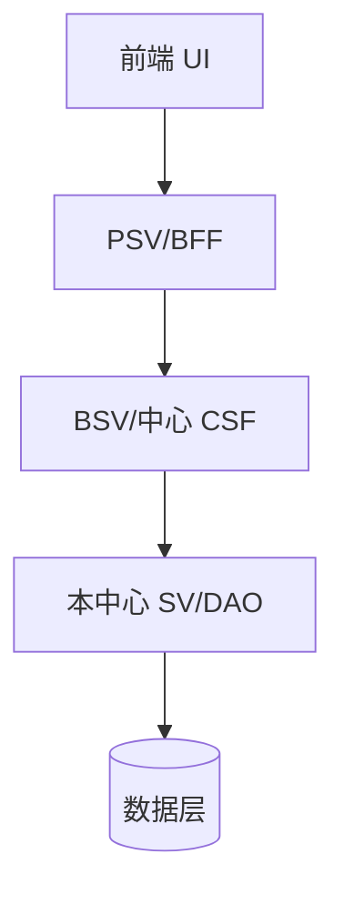

<!--
【文档说明】
承载内容：SDD/OpenSpec 工作流规则、阶段模板或检查清单，指导需求、设计、任务、实现和验证产物质量。
适用范围：按 context-index 对应 stage 加载；stage-end 检查清单用于阶段产物自检。
填充指引：由 SDD 方法论、项目实践复盘和 context-update 维护；保持规则可执行，避免写入单项目业务事实。
加载建议：进入对应阶段或执行阶段自检时加载；always 文档在任务启动时加载。
-->
# 设计发现模板（design-brief-template）

> 用途：`design-brief.md` 是 Design v2 三步流程的第一步，只用于让人类快速审核核心设计方向。它不是证据矩阵、不是设计草稿、不是正式 design。

## 使用指南

1. **生成时机**：完成 proposal/specs 后，进入 draft 前。
2. **核心目标**：用最短内容说明“这个需求准备怎么设计”，让人类能快速判断方向是否正确。
3. **必须简短**：建议 80-120 行内。只写核心决策、核心流程、按场景的核心层次分工和需要人类决策的问题。
4. **不写细节**：不要写完整接口签名、表字段、状态码、组件 ID、DDL、配置 SQL、测试方案。
5. **多场景原则**：一个 change 可以有多个场景。只对命中 playbook 的场景套 playbook，其他场景用轻量或专项设计方式。一个场景可能同时涉及主 playbook 和子 playbook（主场景扩展点引用子 playbook 时），在 Playbook 列同时标注主、子 playbook。
6. **场景级层次归属**：每个核心场景都可能涉及 UI、PSV、多个 BSV/中心、SV/DAO、数据、ET、动态配置和外部系统中的若干层次。必须按场景表达工程/中心归属，不要用一张全局层次表替代所有场景。
7. **决策必须有依据**：brief 中每个场景拆分、playbook 匹配、按场景的工程/中心归属、核心流程、复用/新开发/配置判断，都必须写决策依据。依据不足、冲突或只是推测时，不能写成确定结论，必须进入“需要人类决策的问题”。
8. **三步关系**：
   - `design-brief.md`：核心方向，供人类确认。
   - `design-draft.md`：基于已确认 brief 细化接口、层次工作、数据、配置、证据。
   - `design.md`：基于已确认 draft 生成正式落地设计。
9. **闸口规则**：brief 未确认，不进入 draft；draft 未确认，不生成正式 design。

## 模板

````md
# Design Brief — {change-name}

> 状态：Brief。仅用于确认核心设计方向；未经确认不得进入 design-draft。

## 1. 需求场景与设计方式

| 场景 ID | 场景名称 | 场景类型 | 设计方式 | Playbook（主/子） | 决策依据 | 置信度/不确定处理 |
| --- | --- | --- | --- | --- | --- | --- |
| S1 | TODO | 待补充场景类型 | Playbook/轻量设计/专项调研 | 主：TODO / 子：TODO / 不适用 | proposal/spec/人类指导/playbook/上下文线索 | 高/中/低；低则进入人类决策 |

> Playbook 列填写规则：直接命中填「主：xxx-playbook」；涉及主 playbook 的扩展点子流程时，加填「子：yyy-playbook」。示例：「主：{main-playbook} / 子：{sub-playbook}」。

### 场景拆分判断

- 已覆盖场景：
- 可能遗漏场景：

## 2. 核心层次与工程归属（按场景）

> 按核心场景填写。每个场景只列本场景涉及或影响设计方向的层次；如果某层是否涉及会影响方案，也要写“待确认”。不要为每个场景机械填满所有层次，也不要把拆网、查询、后台联动等场景的工程归属合并成一个全局结论。
> 层次可选：前端 UI、PSV/BFF、BSV/中心 CSF、本中心 SV/DAO、数据层、ET/后台、动态配置、外部系统。

| 场景 ID | 层次 | 关联工程/中心/数据域 | 本场景核心职责 | 本场景处理方式 | 决策依据 | 置信度/不确定处理 |
| --- | --- | --- | --- | --- | --- | --- |
| S1 | 前端 UI | PC/H5/其他：TODO | TODO | 复用/修改/新增/不涉及/待确认 | TODO | 高/中/低；低则进入人类决策 |
| S1 | PSV/BFF | TODO | TODO | 复用/修改/新增/不涉及/待确认 | TODO | 高/中/低；低则进入人类决策 |
| S1 | BSV/中心 CSF | TODO | TODO | 复用/修改/新增/不涉及/待确认 | TODO | 高/中/低；低则进入人类决策 |
| S1 | ET/后台 | TODO | TODO | 复用/修改/新增/配置/不涉及/待确认 | TODO | 高/中/低；低则进入人类决策 |
| S2 | 前端 UI | PC/H5/其他：TODO | TODO | 复用/修改/新增/不涉及/待确认 | TODO | 高/中/低；低则进入人类决策 |
| S2 | BSV/中心 CSF | TODO | TODO | 复用/修改/新增/不涉及/待确认 | TODO | 高/中/低；低则进入人类决策 |

## 3. 核心端到端流程（按场景）

> 只写主链路，不展开接口字段和内部实现。流程可以按单个场景写，也可以把链路完全一致的多个场景合并成一组，但必须标明覆盖哪些场景。

### S1 — TODO 场景名称

1. TODO
2. TODO
3. TODO

流程依据：TODO（来自 proposal/spec/人类流程图/playbook/上下文线索；不确定部分必须标注待确认）



## 4. 核心工作分配

| 场景 ID | 层次/中心/工程 | 复用内容 | 新开发/修改内容 | 配置/人工操作 | 决策依据 | Draft 需继续调研 |
| --- | --- | --- | --- | --- | --- | --- |
| S1 | TODO | TODO | TODO | TODO | TODO | TODO |

## 5. 需要人类决策的问题

| ID | 问题 | 当前依据/冲突点 | 为什么影响设计方向 | 候选处理 | 阻塞级别 |
| --- | --- | --- | --- | --- | --- |
| D-001 | TODO | TODO | TODO | TODO | P0/P1/P2 |

## 6. 进入 Draft 的调研重点

> 只列会影响 draft 的重点，不写全量证据矩阵。

| ID | 场景 | 调研重点 | 目标来源 | 优先级 |
| --- | --- | --- | --- | --- |
| R-001 | S1 | TODO | API Registry / api-drilldown / GitNexus / 源码 / 人类确认 | P0 |

## 7. Brief 自检

- [ ] 只包含核心设计方向，没有展开正式设计细节。
- [ ] 已列出全部已知场景，未命中 playbook 的场景没有被遗漏。
- [ ] 每个场景拆分、playbook 匹配、按场景的工程归属、流程和工作分配判断都有决策依据。
- [ ] 依据不足、证据冲突或推测性判断已进入“需要人类决策的问题”，未写成确定结论。
- [ ] 每个核心场景都已明确本场景涉及的前端、PSV、BSV、SV/DAO、数据、ET、配置、外部系统；没有用全局层次表替代场景级归属。
- [ ] 已区分复用、新开发、配置/人工操作。
- [ ] 已列出需要人类决策的问题。
- [ ] 已列出进入 draft 的最小调研重点。
````
