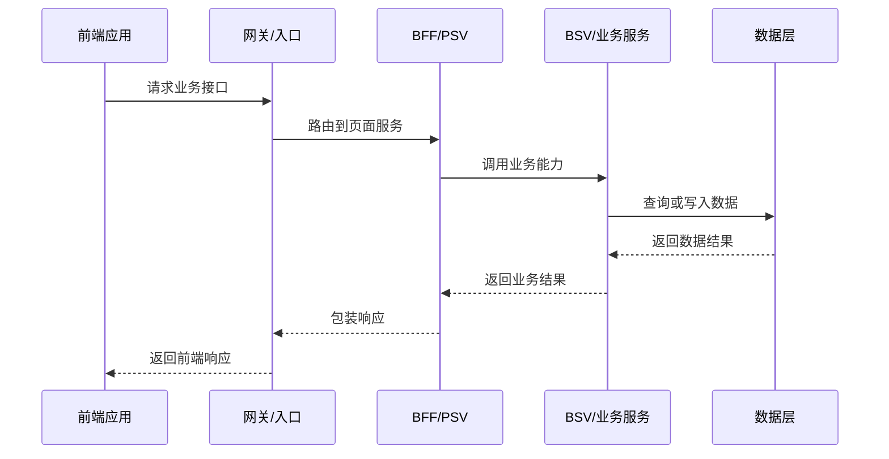
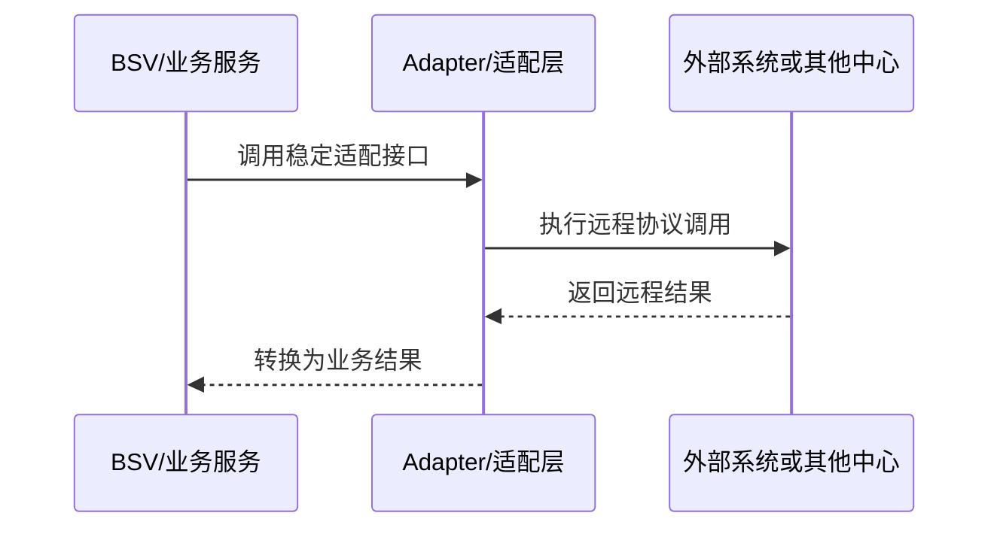
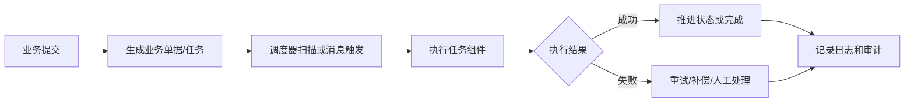

<!--
【文档说明】
承载内容：系统交互关系与调用链，承载关键请求链路、跨系统调用、异步流程和证据占位。
适用范围：proposal/specs/design 阶段用于理解系统边界；tasks/apply 阶段用于定位实现落点。
填充指引：由 project-profile、代码扫描、GitNexus、API Registry、架构访谈和 context-update 补充；图中的模块名和链路必须可被证据校验。
加载建议：命中系统边界、模块能力、接口复用、调用链或架构设计时加载。
-->
# 系统交互关系与调用链（Integration Map）

> 本文提供调用链上下文结构。具体系统名、协议、Header、服务码、接口名和配置必须由源码、注册配置、API 文档或人工确认补充。

---

## 一、系统交互总览

| 调用方 | 被调用方 | 交互方式 | 数据方向 | 说明 | 证据 |
|--------|----------|----------|----------|------|------|
| 待补充 | 待补充 | HTTP/CSF/MQ/本地调用 | 读/写/通知 | 待补充 | GitNexus/API/配置 |

---

## 二、同步请求通用链路

```text
用户操作
  -> 前端请求封装
    -> 页面网关或 HTTP 入口
      -> BFF/PSV 页面服务
        -> BSV/业务服务
          -> DAO/数据源 或 Adapter/外部系统
```



---

## 三、跨系统调用链路



| 约束 | 说明 |
|------|------|
| 协议封装 | 远程服务码、签名、报文和重试策略集中在适配层 |
| 错误转换 | 下游错误转换为项目统一业务异常或结果对象 |
| 日志 | 记录调用目标、业务主键、耗时、错误码和 trace |
| 证据 | 调用关系必须能由 GitNexus、API Registry 或源码确认 |

---

## 四、异步处理链路（占位）



异步链路填充时必须补充：

1. 触发方式：扫描、MQ、人工、定时或外部回调。
2. 幂等键：业务主键、任务号、外部流水或唯一键（以项目为准）。
3. 状态机：待处理、处理中、成功、失败待重试、失败终止。
4. 失败策略：最大重试次数、回查、补偿、告警和人工处理入口。

---

## 五、页面网关路由机制


| 路由项 | 填充内容 |
|--------|----------|
| 路由字段 | Header、path、serviceCode 或 body 字段 |
| 路由配置 | 网关配置、服务注册或代码映射 |
| 目标服务 | BFF/PSV 接口类、方法或服务码 |
| 异常口径 | 路由缺失、服务不可达、超时和权限失败 |

---

## 六、外部系统接口

| 接口名称 | 外部系统 | 协议 | 调用方向 | 超时/重试 | 证据 |
|---------|---------|------|---------|----------|------|
| 待补充 | 待补充 | HTTP/CSF/MQ | 出站/入站 | 待补充 | API 文档/适配层 |

---

## 七、集成约束

| 约束项 | 说明 |
|--------|------|
| 不直连 | 业务层不直接拼远程报文或服务码 |
| 可观测 | 所有跨系统调用保留 trace、耗时和失败摘要 |
| 可补偿 | 有副作用的外部调用必须考虑幂等和补偿 |
| 可维护 | 新增集成同步更新接口目录、API drilldown、测试和安全规则 |
