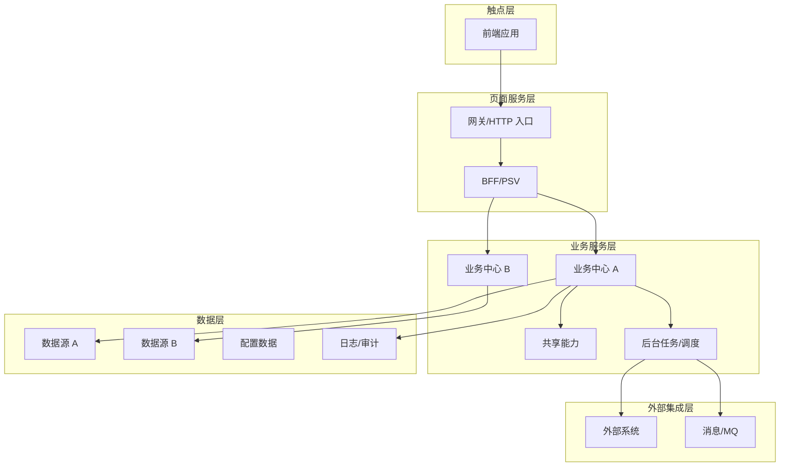

<!--
【文档说明】
承载内容：系统整体架构，承载触点层、BFF、业务中心、外部系统、缓存和数据层关系。
适用范围：proposal/specs/design 阶段用于理解系统边界；tasks/apply 阶段用于定位实现落点。
填充指引：由 project-profile、代码扫描、GitNexus、API Registry、架构访谈和 context-update 补充；图中的模块名和链路必须可被证据校验。
加载建议：命中系统边界、模块能力、接口复用、调用链或架构设计时加载。
-->
# 系统整体架构（Architecture Overview）

> 本文提供目标工作区的架构描述结构。图中的模块均为通用占位，初始化后应由 project-profile、代码扫描和人工确认替换为真实模块。

---

## 一、系统定位

| 维度 | 说明 |
|------|------|
| 业务定位 | 目标工作区承载的业务域、渠道或系统能力 |
| 技术定位 | 前端、BFF/PSV、BSV、后台任务、数据层或多仓组合 |
| 集成定位 | 上游调用方、下游系统、消息、网关和外部平台 |
| 数据定位 | 主数据、交易数据、配置数据和日志数据的归属 |

---

## 二、技术栈

| 层级 | 技术 | 版本 | 证据来源 |
|------|------|------|----------|
| 前端 | 待补充 | 待补充 | package.json/构建脚本 |
| BFF/PSV | 待补充 | 待补充 | 源码/服务注册 |
| BSV | 待补充 | 待补充 | 源码/构建脚本 |
| 数据层 | 待补充 | 待补充 | DB 字典/.bo/配置 |
| 后台任务 | 待补充 | 待补充 | 调度/Task/Job 配置 |

---

## 三、子系统/仓库划分

| 子系统 | 类型 | 仓库路径 | 语言/框架 | 系统层级 | 说明 |
|--------|------|---------|----------|---------|------|
| 待补充 | frontend / bff / bsv / task / data / external | 待补充 | 待补充 | 待补充 | 待补充 |

---

## 四、分层架构（占位）

> 上图仅为分层占位；具体模块名、仓库名和调用关系须由 project-profile 与代码证据替换。

---

## 五、部署拓扑补充模板

| 节点/服务 | 部署方式 | 依赖 | 扩缩容/容灾 | 证据 |
|-----------|----------|------|-------------|------|
| 待补充 | 单体/集群/容器/批处理 | 待补充 | 待补充 | 部署文档/配置 |

---

## 六、架构特征总结

| 特征 | 说明 |
|------|------|
| 分层 | 前端、页面服务、业务服务、数据和外部集成职责分离 |
| 复用 | 设计阶段优先查接口目录、API drilldown 和代码模式 |
| 可追溯 | 架构图中的模块和调用关系必须能追溯到项目证据 |
| 可演进 | 新仓库、新模块和新外部依赖通过 context-update 同步维护 |
